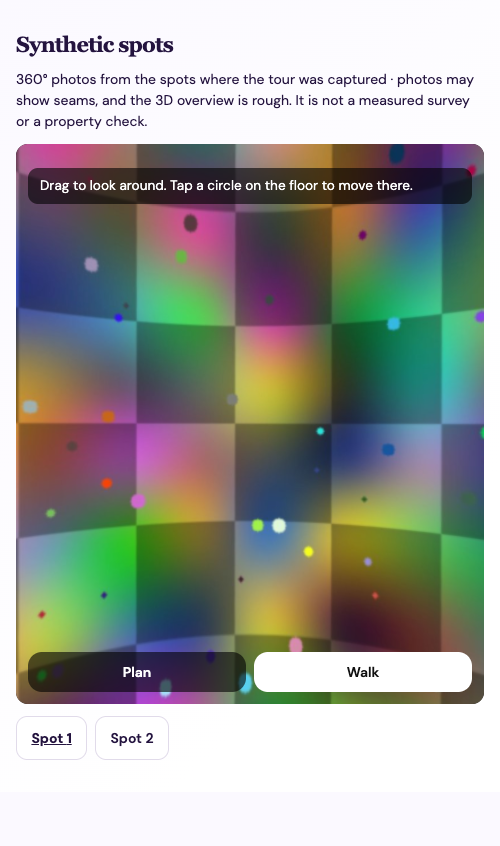
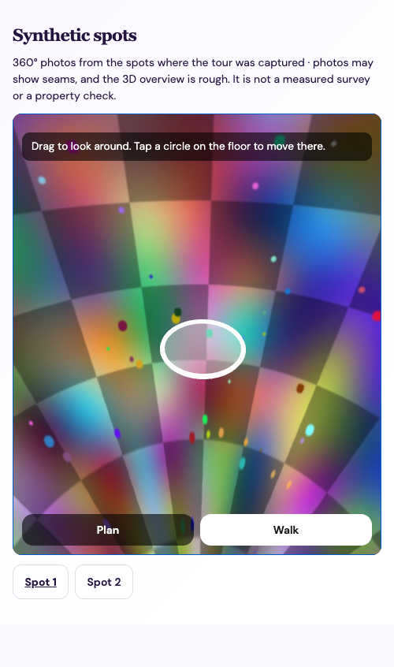
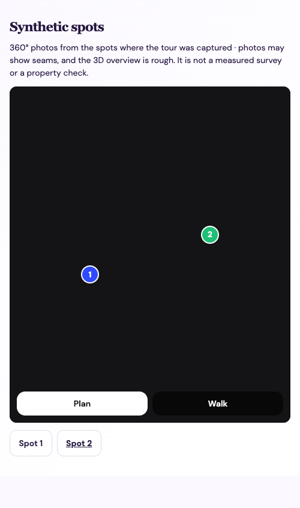

# Photographic room tours

The iPhone app captures overlapping, calibrated ARKit camera views. The server stores the capture privately, a separate serial worker trains a Gaussian model, and the owner reviews and explicitly publishes it. Public access also requires a published listing and an active owner. RoomPlan geometry remains a separate feature. Neither output grants a CuseSublets Check.


## Spot tours

New tours use **spot capture**, modelled on Matterport-style phone capture and Street View-style viewing. The sublessor stands at a few spots and turns in place under guidance. Each spot becomes a stitched 360° photo. Viewers stand only at those spots and move by tapping circles on the floor. A rough room mesh, when the processor builds one, powers the overview and the move between spots. The design is in [the spot tour spec](../superpowers/specs/2026-11-12-spot-capture-tours-design.md).

### Capture (`SpotRecorder.swift`, `SpotTurn.swift`, `SpotCaptureScreens.swift`)

- **One ARKit session per tour.** ARKit's world tracking only offers the 1× camera, so it places the spots and draws the capture map, and is paused while the 0.5× camera turns at a spot (see below). An interruption, backgrounding or lost camera ends capture. Finished spots are kept and can still be generated; an unfinished spot is discarded. If tracking is lost mid-turn, that spot is discarded and the next one waits until tracking is normal again.
- **Turning at a spot** (`WideCamera.swift`, `SpotOrientation.swift`). The turn uses the **0.5× (ultra-wide) camera** with lens correction on, which in portrait sees about 90° across and 105° up and down. A fixed circle sits in the middle of the screen and the next dot is drawn over the camera view; when the dot is off screen, a dotted line points towards it. Holding the circle on a dot for 0.5 s (within 4°, turning slower than 0.35 rad/s) captures one *slice*. The layout has **6 dots**: one level turn at 60° steps, with no shot of the ceiling or the floor, so the person never has to look up or down and is never in a picture. The screen is black space in which each shot stays where it was taken. **Undo** removes the last slice. Exposure and white balance lock when the first dot is lined up, so slices blend without banding.
  - Each slice's rotation comes from the motion sensors (Core Motion, gravity-referenced). When the spot starts, the app reads ARKit's camera rotation and the motion attitude at the same moment and solves the fixed turn between the two frames, so slices are recorded in ARKit's world. The spot's position is where ARKit had the phone at that moment.
  - After the turn ARKit starts tracking afresh, and its first tracked frame is lined up with the tour's world: the motion sensors kept the phone's heading through the turn, and the phone is assumed to have swung on a 0.35 m arm around the person. (A paused session resumes as if the phone had not moved, which misplaced later spots on the first device run.) **Not yet verified on a device:** how well later spots line up. A spot that is still misplaced can be dragged on the map before generating.
  - The earlier layout used the 1× camera and 29 dots. The first device run (2026-11-12) showed doubled doors and ghosted furniture where its many slices overlapped; see the [device results](spot-capture-device-results.md).
- **Capture map.** Between spots, the app shows the captured room from above, built from the same on-device depth as the coverage overlay. It shows numbered spots, where the phone is now, and a percentage. The percentage is the share of floor seen so far that a finished spot can see within 1.5 m, with walls and furniture between 0.3 and 1.8 m above the floor blocking the line of sight. It is guidance, not a measurement; floor the camera never passed over doesn't count. While walking, the camera keeps saving *walk* frames (up to 90) with the existing sharp, trackable, parallax policy. These feed only the mesh.
- **Review.** Each spot can be previewed as a rough 360 (slices placed where they were captured, not stitched), redone while the session is live, or deleted. **Generate tour** packages the take.
- **Limits.** A tour has at most 8 spots. Slices and walk frames are saved 1920 px wide. The archive must stay within **96 MB**, below the Workers request-body limit. A spot starts only if a whole spot of slices still fits.
- **Storage.** Spot takes live under Application Support `spot-captures/`, separately from walk-around takes, with the same file protection and backup exclusion. `frames.jsonl` records each frame's `role` (`walk` or `slice`) and `spot`. `spots.jsonl` records each finished spot only after all its slices are written, and a tombstone line records a deletion. The archive's `manifest.json` is schema version 2 with `capture: "spots"` and a `spots` list.

### Processing (`processing/spot_stitch.py`, `processing/tour_worker.py`)

The API stores `kind = 'spots'` (migration `0020_spot_tours.sql`), and the claim tells the worker the kind. The worker runs these steps:

1. It unpacks the archive safely: only the app's file names, regular files, no links or duplicates.
2. It loads only the slices listed in finished spots. A manifest is refused if it reuses a slice, exceeds 8 spots or 64 slices per spot, declares images over 1920 px, or exceeds a per-spot pixel budget. The JPEG header is checked before decoding, and OpenCV's own pixel cap is set.
3. It refines each slice's rotation by up to 3° using ORB feature matches between overlapping slices. Each overlapping pair is first redrawn through one shared pinhole view aimed between the two, because wide slices stretch the same surface differently at their edges. A slice is compared with at most six neighbours. The shared turn the matches cannot see is removed, so the set stays anchored to the sensors.
4. It evens out exposure with per-slice gains and blends slices with feathering into a 4096 × 2048 equirectangular JPEG (quality 85). Yaw 0 is ARKit −Z; columns grow clockwise seen from above. The level shots reach about 50° above and below level; the ceiling and floor beyond that are filled with blurred colour and are not holes. Holes are counted in the band of rows the shots cover, so a missing level shot still fails. Spots from earlier builds also have a ceiling and a floor shot: the floor shot shows the legs of the person holding the phone, so it is used only where the level shots do not reach and only on the side away from them, and a neutral disc below −80° pitch covers the floor under them. A spot with more than 2% uncovered sphere above that fails as `spot_incomplete`.
5. With `CUSE_ROOM_MESH=1`, it builds the room mesh from walk frames plus level slices.
6. It uploads one USTAR bundle (panoramas, then `spots.json`) and records each panorama's byte range in the result. `GET /api/listings/{listing}/tours/{tour}/panorama/{spot}` serves one panorama by range, with the same visibility checks as the model.

Install `processing/requirements-spots.txt` into the worker's Python environment. On the Mac mini, a 4096-wide spot stitches in about 12 s.

### The scanning app and Tour Studio (`PropertyViews.swift`, `studio/server.py`)

The **Cuse Capture Test** scheme is a standalone scanning app, separate from the marketplace:

1. **Properties.** Add a property and name it. The list shows whether each is not scanned, scanned or generated.
2. **Before you scan.** A short guide (light, privacy, where to stand), then **Start scan**.
3. **Scan.** The capture map and the spot turns described above.
4. **Review.** The spots on a map, a rough 360 preview of each, **Generate tour** and **Scan again**.
5. **View 360° tour.** The stitched tour in the spot viewer, inside the app.

Generating uploads the capture archive to **Tour Studio**, a small private service (Python standard library) that runs `tour_worker.py --reconstruct-spots` in a child process and serves the result through the same spot viewer on a standalone page (`studio.html`, built with `npm run build:studio`).

```sh
npm ci && npm run build:studio
python3 -m venv work/spots-venv && work/spots-venv/bin/pip install -r processing/requirements-spots.txt
APP_DATA_DIR=work/studio-data PORT=8937 STUDIO_TOKEN=<your token> work/spots-venv/bin/python studio/server.py
```

- **Login.** Set `STUDIO_TOKEN` (at least 32 letters and digits) and every request except `/health` must carry it: the app sends it as a bearer header, and a browser gets a cookie after entering it at `/signin`. Without `STUDIO_TOKEN` the service has no login and must stay behind an authenticating proxy or on a private network. Generate one with `python3 -c "import secrets; print(secrets.token_hex(24))"` and keep it out of the repository.
- **Hostnames.** It answers only requests addressed to its loopback address or to a hostname in `STUDIO_HOSTS`, and changes need a header a cross-site form cannot send.
- **The app** talks to it over https at the address and token set under **Settings** (or passed once as the launch arguments `-studioURL` and `-studioToken`). The token is kept in the iPhone's Keychain. A native app cannot complete a browser sign-in such as Cloudflare Access with Google, so the address must not sit behind one.
- Captures and tours hold real room photographs. They stay under `APP_DATA_DIR` and are removed with the property.
- `studio/launcher.json` registers the service with the author's personal app launcher; it is an example, not a portable deployment.

### Viewer (`src/SpotViewer.tsx`)

The same page runs in the iPhone app's web view and on listing pages. **Walk** shows the 360 at the current spot: drag or use the arrow keys to look, and tap a floor circle (other spots within 6 m) to move. **Plan** shows the spots from above, over the mesh when there is one. **3D** orbits the mesh, and appears only when the tour has one. Spot buttons under the viewer reach every spot without the canvas. Panoramas load one at a time: the current spot first, then nearby spots.

  

These screenshots come from the **synthetic** fixture (`python processing/make_synthetic_capture.py --spots OUT`), not a real room.

### Verified and not yet verified

- **Verified (2026-11-12):**
  - Unit tests for the turn state, coverage, storage and recovery, session rules, API contract, stitching and worker.
  - The synthetic archive processed end to end against the isolated API.
  - The viewer checked in headless Chrome: orientation against a reference render, a floor-circle tap, and Plan mode.
- **Verified (2026-11-12, later):** the 29-dot 1× capture ran on an iPhone 17 and its archive stitched with no holes but visible ghosting. The 8-dot 0.5× capture, the property flow and Tour Studio pass their unit tests, the simulator UI test and an end-to-end upload of a real archive to the deployed service.
- **Not yet verified:**
  - The 0.5× capture on a real iPhone: the lens's actual field of view, the motion-sensor rotations, ARKit finding its place after each turn, and seams with 8 slices.
  - The scanning app's upload and viewer on a real iPhone.
  - The mesh-based 3D mode and fly-through.

  See [the device results](spot-capture-device-results.md).

## Walk-around tours (development comparison)

The sections below describe the earlier walk-around Gaussian capture. Marketplace tours now use spot capture; the walk-around flow remains on the development **Device capture check** screen for comparison, and existing walk-around tours keep their viewer.

## Capture and recovery

Photographic capture uses AR world tracking on supported iPhones; LiDAR is not required. The simulator cannot validate capture. Move slowly around one room with good light and overlapping views, stepping sideways between views. At least 30 stable views are required; aim for 60 or more. Capture stops at three minutes or 180 views, the limits of the processing engine.

The app chooses views silently: it saves a camera frame only when it is likely to help reconstruction (`PhotoCapturePolicy.swift`):

- **Sharp.** The expected smear from camera motion during the exposure, `(turn rate + speed / distance) × exposure × focal length`, must stay under 4 pixels. Dim rooms need slower movement.
- **Parallax.** A new view needs a sideways step of about 6% of the distance to the room (6–20 cm). Turning in place counts as a new view only twice in a row, because rotation alone gives reconstruction no depth.
- **Trackable.** At least 40 tracked features in view.
- At least 0.4 s apart, under 0.6 m/s and 0.9 rad/s, with normal tracking and enough light.

Views keep the camera's full 1920 × 1440 resolution. JPEG quality adapts to the 64 MiB upload limit: each view gets an equal share of the remaining space after reserving manifest space for every view still possible, so a busy room gets lower quality instead of a take refused at the end. Encoding and file writes run off the camera thread. Poorly textured walls, mirrors, occlusions and camera drift can still make reconstruction unusable.

Camera JPEGs, poses and feature points are saved under an owner/listing-specific directory with device file protection and excluded from backup. Each view's image is written before its record is appended to `frames.jsonl`; recovery keeps the complete views up to the first incomplete one, and packaging builds `manifest.json` from them. Takes saved by earlier builds, which have only `manifest.json`, still package. An interruption ends the coordinate system; it never silently resumes a new tracking origin. Reopening recovers the saved take. Fewer than 30 views requires a new take. Review source images for personal papers, faces and other private details before upload.

### Coverage overlay

While capturing, the camera view shows which surfaces have been captured well enough for reconstruction. Unseen areas have a blue tint. Seen surfaces appear as small squares: amber when seen from one direction, light yellow from two, and nearly clear once seen from three directions at least 15° apart. A caption reports the covered share of seen surfaces as text, so the overlay does not rely on colour alone.

The overlay works without LiDAR. A bundled Core ML model ([Depth Anything V2 Small](../../THIRD_PARTY_NOTICES.md)) estimates relative depth from camera frames: every saved view, plus sharp, tracked frames at most four times a second, so the overlay fills in as the camera sweeps instead of only when a view is saved. Frames rejected for motion, blur or too few features do not paint. ARKit's tracked feature points convert it to metres by fitting inverse depth `1/z ≈ a·p + b`, and the result is added to a 10 cm voxel map. Views whose tracked points cannot fit the depth map are skipped for the overlay but still saved. The model runs on a background queue; a frame arriving while the previous estimate is still running is not added to the overlay. Because covering a surface from three directions requires moving between positions, the views saved along the way normally cover it too; surfaces seen only while turning in place stay amber.

Depth maps and the coverage map stay in memory and are not written to the take or uploaded. Limits: depth from one image is approximate, so the overlay is guidance, not a measurement. Mirrors, glass and blank walls with few tracked points may stay blue or show stray squares. The map is not saved, so a recovered take shows no overlay.

### Guidance

Normal capture shows no changing instructions; the overlay is the guidance. A short hint appears over the camera only when a problem lasts: 0.6 s for moving too fast, blur, lost tracking, low light or a view with too few features, and 1.5 s for turning in place without stepping sideways. A hint stays up 0.6 s after the problem clears, so it does not flicker.

### Camera stream recording (development only)

The development-only **Device capture check** screen also records a camera stream alongside the take (`CaptureStream.swift`). Marketplace captures never record one. Every 0.2 s it saves a 640 × 480 JPEG with that frame's calibration, pose, tracking state, shutter time, light estimate and up to 300 tracked points. It also saves what the view rules decided for that frame: the reason it was saved or skipped (for example `blurred`, `fewFeatures` or `noNewViewpoint`), the measured speed, turn rate, distance and predicted blur, and any hint shown. `summary.json` totals the seconds spent in each reason over every camera frame and lists the thresholds in force.

The frame is shrunk on the camera thread so ARKit's buffer is released at once; encoding and writing run on a background queue, and a frame due while the previous one is still being written is dropped and counted. Recording stops at 200 MB while capture continues; a three-minute take is typically 40–50 MB. **Prepare camera stream recording** packages it as `room.roomstream`, an uncompressed USTAR archive of `summary.json`, `stream.jsonl` and `frames/NNNNN.jpg`. It is not a capture archive and cannot be uploaded for processing. It contains room photographs: keep it private, and discard the take to delete the local copy.

Archives and trained models are limited to 64 MiB. Upload streams from disk and checks size plus SHA-256 on the server. Keep the app open during upload. An interrupted upload retries the whole bounded file with the same capture ID, not individual byte ranges. Retrying cannot create duplicate jobs or replace an already accepted archive. After the server accepts the upload, the app removes its local source copy. Owners can delete server captures and models; downloaded copies cannot be recalled.

## Processor setup

The app and API can run without a processor; the capture screen clearly reports that processing is unavailable. To enable it, apply migrations `0013_room_tours.sql`, `0014_tour_deletions.sql` and `0019_tour_meshes.sql` using the deployment runbook, then configure a private `TOUR_PROCESSOR_TOKEN` of at least 32 random characters both in the Worker and worker environment. Do not commit this value. The processor needs outbound access to the API; no inbound processor endpoint is exposed.

The adapter reuses the existing [apartment-3d-lab capture engine](https://github.com/ichen27/apartment-3d-lab/tree/b1099a13eb8a6874f91ec92a63b9a2f444a31c2b), pinned to that revision. Clone it into a separate dependency directory, check out that commit, create a Python environment, and install its `requirements-capture.txt`. This dependency's repository access is required; it is not bundled with the marketplace. Install a compatible Brush 0.3 Apple Silicon CLI separately. Preserve its upstream license and obtain the binary from its upstream release. No research-room datasets or customer photographs are distributed here.

Set these environment variables using your service manager or private environment file:

```sh
export CUSE_PROCESSOR_API=https://YOUR_APP_HOST
export TOUR_PROCESSOR_TOKEN=YOUR_PRIVATE_PROCESSOR_SECRET
export CUSE_CAPTURE_ENGINE=/absolute/path/to/pinned/apartment-3d-lab
export CUSE_BRUSH=/absolute/path/to/brush_app
export CUSE_PROCESSOR_WORK=/absolute/path/to/private/temporary/jobs
python processing/tour_worker.py
```

Use the Python interpreter from the capture engine's environment. The placeholder secret above must be replaced, not used literally. `CUSE_PROCESSOR_ORIGIN` can separately supply the configured Worker Origin when a local reverse proxy rewrites it; normally it equals the HTTPS API origin. Only HTTPS or explicit loopback HTTP is accepted, and authenticated redirects are refused.

### Optional room mesh

With `CUSE_ROOM_MESH=1`, the processor also builds a coloured triangle mesh after Gaussian training (`processing/room_mesh.py`). It needs, in the same Python environment:

- [Depth Anything 3](https://github.com/ByteDance-Seed/Depth-Anything-3), installed from a checkout of commit `3d835ec1a5802d64a8b8b15f817a1ab54809bfe4` with `pip install -e .`. Its code is Apache-2.0.
- The `depth-anything/DA3-BASE` weights, which the upstream model table lists as Apache-2.0. Larger DA3 variants are CC BY-NC 4.0 and must not be substituted for commercial use. Download the weights once and point `CUSE_DA3_MODEL` at the local directory so processing never fetches models at run time.
- Open3D 0.19 and PyTorch 2 with Metal (MPS) or CUDA. The pipeline was validated on an Apple M-series Mac mini with 16 GB of memory.

```sh
export CUSE_ROOM_MESH=1
export CUSE_DA3_MODEL=/absolute/path/to/DA3-BASE
```

The step selects up to 60 evenly spaced views and estimates their depth in one Depth Anything 3 pass, conditioned on the ARKit poses and intrinsics. Processing separate windows of views gave each window its own scale, up to 30% apart, so the view count is capped instead. Pixels below the 40th confidence percentile, outside 0.2–5 m, or across object edges are dropped. The rest is fused into a 2 cm TSDF grid; fragments under 200 triangles are removed and the mesh is simplified to at most 300,000 triangles. It is written as a binary PLY with vertex colours in ARKit world coordinates (metres, +Y up), with metadata for the API. The mesh is uploaded to `/api/tour-processor/{id}/mesh` before completion, under the same claim. Completion keeps only the mesh uploaded by the completing claim, so a mesh from an earlier failed attempt is never shown with a later result. If the mesh step fails or the API rejects the mesh, the tour still completes without one; only the error type is logged.

On the iPhone 17 test scan (91 views), one pass took about 35 s, and the whole job including Gaussian training took 229 s. Measured after simplifying to 35,000 triangles, the mesh's surface roughness fell from 7.2 mm to 4.1 mm compared with fusing the app's single-image depth model. Its share of surface on the six largest planes rose from 19% to 29%. Views six seconds apart agreed within 2.2%, against 17% for the single-image model. Expect holes where no view saw a surface confidently, soft edges, and doubled surfaces if ARKit tracking drifted. It is a reconstruction from photographs, not a measured survey.

Each claim lasts three minutes and is renewed every 45 seconds. Results commit only while the same claim still owns the job. A lost lease stops training; expired jobs can be reclaimed, and three interrupted claims fail visibly until the owner retries. Deleting a job invalidates active workers. Heartbeat, failure and completion writes also recheck owner activity. Use a restart-on-failure service manager for continuous operation. Processing is serial, bounded to 500,000 Gaussians and 3,000 training steps, with a training timeout. This is experimental quality, not a guaranteed photorealistic output.

Working files are private and removed after each completed or failed job. Abrupt machine termination can leave temporary directories; inspect and remove abandoned job directories as part of operating the service. Original captures remain in private object storage until the owner deletes the tour. Opaque deletion IDs are retained in a cleanup ledger; processor polls sweep that ledger so a late upload cannot strand files after a failed cleanup request. A failed sweep keeps its record for retry, and deleted capture IDs cannot be reused. Define a retention policy before a public release.

## Viewing and export

The same lazy-loaded PlayCanvas viewer runs on public listing pages and in an ephemeral, same-origin iPhone web view. Cookies are never placed in URLs. Model requests recheck visibility and account/listing status. Drag to look; use the labeled movement controls or arrow keys, and reset if lost. Movement has no wall collisions. An unsupported graphics device shows an error and offers PLY export.

The exported Gaussian PLY contains Gaussian attributes. A Gaussian-compatible Blender importer is needed; it is not an editable architectural mesh. When processing built a room mesh, **Export room mesh (PLY)** downloads it from `/api/listings/{listing}/tours/{tour}/mesh` with the same visibility rules as the model. It is an ordinary coloured triangle mesh that opens in Blender, MeshLab and most 3D tools. Blender-authored staging should be presented separately and labeled as edited, rather than represented as a capture of the available room.

## Reproducible synthetic validation

[Synthetic capture archive](fixtures/synthetic.roomcapture) contains 30 constant-color 96×64 images and artificial poses/points. [Trained Gaussian PLY](fixtures/synthetic-tour.ply) is actual Brush output from that input, with [result metadata](fixtures/synthetic-tour-result.json) recording display metadata. These are transport and engine compatibility artifacts, **not evidence of real-room visual quality or dimensional accuracy**. Regenerate the archive with:

```sh
python processing/make_synthetic_capture.py docs/mobile/fixtures/synthetic.roomcapture
```

The generator requires Pillow, already included in the capture engine environment. Start the isolated API on port 8936 with the test processor token, then run `tests/tours-runtime.py` as documented in the validation page. Never use tests against operational data. `processing/tour_worker.py --once` handles one queued job with the configured engine. The API tests cover authorization, private/public transitions, visibility revocation, checksum failure, retry, competing uploads/claims and deletion fencing. Real capture/recovery, hosted upload and visual quality remain physical-device release gates.
