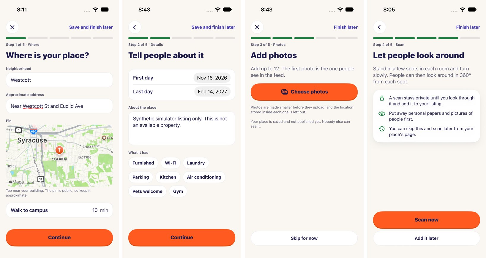
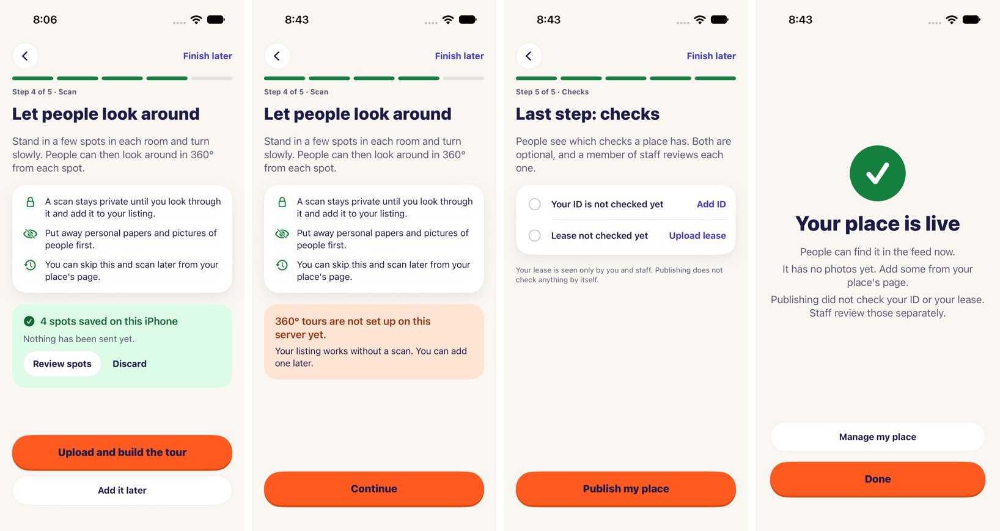
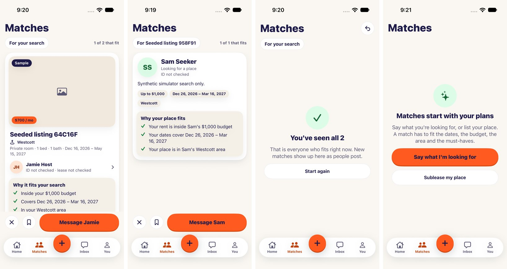
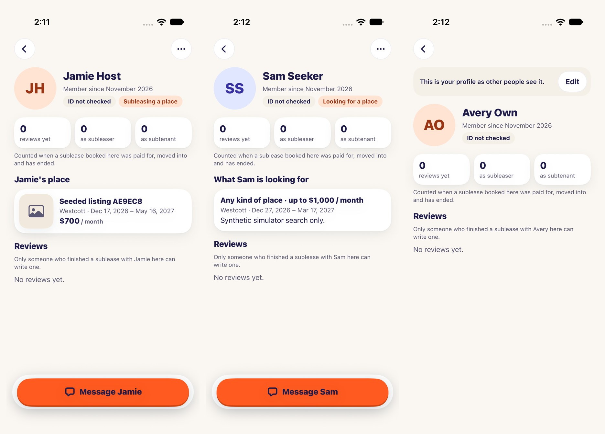
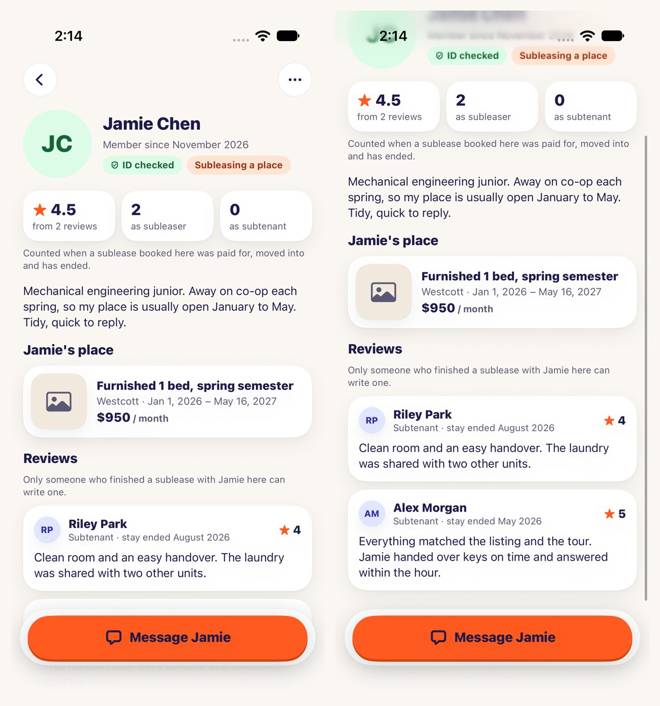

# Quad: the iPhone app's redesign

The iPhone app is being redrawn and renamed from CuseSublets to **Quad**. This page records the look, what has been rebuilt so far, and what is still in the old style. The repository, bundle identifier and server keep the CuseSublets name.

## Status

| Part | State |
| --- | --- |
| Colours, buttons, cards, chips, avatars, logo | Built (`QuadTheme.swift`) |
| App name on the home screen, app icon | Built ("Quad", three squares and an orange circle on indigo) |
| Floating tab bar with a raised Post button | Built (`QuadTabBar.swift`) |
| Home feed | Built (`BrowseView.swift`, `QuadFeed.swift`) |
| A sublease's page | Built (`ListingView` in `BrowseView.swift`) |
| Listing a place in five steps, with photos, a scan step and checks | Built (`ListingFlow.swift`, `ListingSteps.swift`) |
| Matches, one at a time | Built (`MatchesView.swift`, `MatchDeck.swift`) |
| A person's profile | Built (`MemberView.swift`, `PersonProfile.swift`) |
| Inbox and chat, You, editing your own profile, a housing search's page | Old style, under the new tab bar |
| Sign-up questions | Not built |
| Scan and tour screens in the new colours | Not built |
| Building pages, building managers, staff tools in the app | Not built; these need new server features first |

Only light appearance is drawn. The app is locked to light until a dark palette exists.

The name has not had a trademark or App Store check. Other student apps already use "Quad", so the App Store listing will need a longer form such as "Quad: Student Sublets".

## The look

Each colour has one job.

| Colour | Value | Used for |
| --- | --- | --- |
| Orange | `#FF5A1F` | The main button on a screen, the Post button, prices |
| Deep orange | `#C2410C` | Orange that must be readable as text on white: the active tab, links in old screens |
| Green | `#15803D`, tint `#DCFCE7`, text `#166534` | Yes and done: check badges, "fits", selected answers, progress |
| Indigo | `#4F46E5`, text `#1E1B4B` | Kept small: the logo tile, body text, dark chips |
| Warm white | `#FAF7F2`, wells `#F4F0E8` | Backgrounds |

Main buttons carry dark text. White on this orange measures about 3:1, below what small text needs.

Cards are flat white with one soft shadow. Only main buttons look pressable, with a darker lower edge. Buttons shrink a little when pressed and spring back; this is skipped when Reduce Motion is on.

## How the pieces fit

- `QuadTheme.swift`: colours, `ButtonStyle`s (`.quadPrimary`, `.quadPrimaryWide`, `.quadSecondary`, `.quadIcon`), `quadCard()`, `QuadChip`, `QuadAvatar`, `QuadLogo`.
- `QuadFormat.swift`: text rules with no interface in them: date ranges ("Jan 5 – May 15"), initials, which avatar tint a person gets, and the four tabs.
- `QuadTabBar.swift`: the tab bar, the Post intent, and `QuadFlow`, a wrapping layout for chips.
- `QuadFeed.swift`: the two feed cards and the filter chips.

The system tab bar is hidden and `QuadTabBar` is drawn over the bottom of the tab view. Two details matter when adding screens:

- Every scrolling screen inside a tab gets a bottom margin (`QuadTabBar.reservedHeight`) so its last line clears the bar. A safe-area inset on the tab view or the navigation stack did not reach the screens inside, so this is a scroll-content margin set on each tab's stack.
- That margin also reaches strips that scroll sideways and adds a blank band under them. Put `.quadSidewaysScroll()` on any horizontal `ScrollView` inside a tab.

A screen with its own bar at the bottom, such as a sublease's page with its price bar, calls `.hidesQuadTabBar()` and drops the tab's bottom margin. Both floating bars use `quadBarFade()` so that content scrolling under them does not show through below.

A sublease's page shows the photos first, with a "Look around in 360°" button when the place has a published tour that is ready. It lists what staff have checked and, as plainly, what they have not: the person's ID and the lease. Sublet permission is no longer shown as a check.

The Post button asks a guest to log in. For a member it offers "Sublease my place" or "Say what I'm looking for", switches to the You tab and opens the listing steps or the search editor there, because the You tab already owns both.

## Listing a place

Listing a place is five steps: where, details, photos, scan, checks.

1. **Where.** Neighborhood, an approximate address, a public pin and the walk to campus.
2. **Details.** Title, private room or entire place, rent, bedrooms and bathrooms, dates, a description and one-tap amenities. "Continue" creates the place on the server, unpublished (`publish: false` on `POST /api/listings`). Photos, a scan and a lease all attach to a place, so the place has to exist before they can be added. Nobody but its owner and staff can see it.
3. **Photos.** Up to 12 from the photo library. Each is redrawn no larger than 2048 pixels on its long side and saved as a JPEG under the server's 5 MB limit. Redrawing leaves behind what the camera stored inside the file, including where the photo was taken.
4. **Scan.** "Scan now" opens the spot capture, and "Add it later" skips it. After a scan the step offers "Upload and build the tour". The tour stays private until its owner looks through it and publishes it from the place's tours page. The step says why when scanning is not possible: the server has no tour processing configured, or the device cannot track its position.
5. **Checks.** Upload a lease and add an ID, both optional, both reviewed by staff. "Publish my place" makes the place live. Publishing checks nothing by itself, and the screen that follows says so.

Leaving early keeps the work. Before the place exists, "Save and finish later" stores a private draft, listed under Private drafts in You. Afterwards, "Finish later" leaves the place under Your places marked "Not published", and its page offers "Add photos, a scan and checks in steps".

The rules for moving between steps, the scan choices and the photo preparation have no interface in them and live in `ListingSteps.swift`, with tests in `ListingStepsTests.swift`.

Known limits:

- A photo cannot be removed or reordered in the app. The server has no route for it.
- Once the place exists, the first two steps cannot be reopened. Their answers are changed with "Edit details" on the place's page, which is still the old one-page editor.
- There are no buildings to pick from. The server has no building records yet, so step one takes a neighborhood and an address.
- The steps do not ask for a Matterport or video link, which the old editor did when creating a place. A video can still be uploaded from the place's page. A Matterport link can no longer be set from the app.
- A server from before this change ignores `publish: false` and publishes the place at once. The steps notice this, say that the place is already published, and end with "Finish".





The "Scan now" and "4 spots saved" pictures were made by forcing those states in a simulator, which cannot scan. The others are from the interface tests.

Interface tests find the tabs by identifier: `tab-home`, `tab-matches`, `tab-post`, `tab-inbox`, `tab-you`.

## Matches

Matches shows one match at a time for one of the signed-in person's plans: their housing search, or one of their published places. A chip names the plan and, when there is more than one, switches between them.

- **For a search**, the card is a place: photo, rent, a "360° tour" chip when a published tour is ready, title, neighborhood, the stay, and the person subleasing with what staff have checked.
- **For a place**, the card is a person who is looking: name, ID check, their introduction, budget, dates and areas.
- **Why it fits.** Each card lists the reasons with the person's own numbers in them, such as "Inside your $1,000 budget" or "Your place is in Sam's Westcott area". The server alone decides whether a place and a search match. The phone only words the reasons, from the place and the search it already has; without both it shows the server's plainer wording.
- **Three actions.** Pass, Save for later (a private save, listed under Saved posts in You) and Message (opens the conversation in the Inbox). Each moves on to the next match. Dragging the card left passes and dragging it right saves; a label on the card says which before the finger lifts.
- **Going back.** An arrow in the header brings back the last match. After the last one, "Start again" shows them all from the top.

What has been seen is remembered on the phone, for each person and each plan, so the deck picks up where it was left. The server does not record it: another device starts from the top, and passing tells nobody anything. Deleting an account removes that person's list from the phone.

The parts of the card that open another screen respond to a tap and are deliberately not buttons. The card follows a dragging finger, and a button under that finger treats the lift as a press, which opened the place at the end of every swipe.

The deck, the swipe threshold and the wording have no interface in them and live in `MatchDeck.swift`, with tests in `MatchDeckTests.swift`.

Known limits:

- Dragging right to save was not in the agreed mockup, which had buttons only.
- The mockup named a building and a walk to campus on the card. There are no building records, and the app does not read a walk time for a place, so the card shows the neighborhood.
- The card shows the first photo only. The rest are on the place's page.
- The server returns at most 50 matches for a plan.
- What a person is looking for still opens in the old style.



## A person's profile

A profile opens from a sublease's page, a match, a comment or a conversation. Your own opens from You, under "See your public profile".

- **Who they are.** Photo or initials, name, the month they joined, and chips: "ID checked" in green when staff have checked their ID and "ID not checked" when not, then what they are doing now ("Subleasing a place", "Looking for a place").
- **What they have finished here.** Three numbers: the average of their reviews, subleases finished as the subleaser, and subleases finished as the subtenant. A sublease counts when it was booked here, paid for, moved into and has ended, and is neither cancelled nor in an open dispute. That is the same rule that lets its two people review each other. The screen says this under the numbers.
- **Their places and what they are looking for.** Each place opens its page. The search opens the housing search's page, which is still in the old style.
- **Reviews.** Each says who wrote it, which side of the sublease they were on, the month the stay ended, and their stars. Only someone who finished a sublease with the person can write one, and the screen says so. When you are that someone, a "Review" card appears under the reviews.
- **Message.** A conversation here is always about a place, so the button offers what there is to talk about: any place the person has listed, then any place of yours that fits what they are looking for. With one choice it opens the conversation; with several it asks which. With none there is no button, and a line at the bottom says why.
- **Block or report** sit behind the round button at the top right. Blocking hides the profile at once.

The server gained three things for this, all on `GET /api/users/:id` (`worker/profile-history.ts`):

- `profile.joinedAt` is now the month an account was created (`yyyy-MM`). The column has existed since the profiles migration, but nothing wrote it. A new migration (`0021_joined_at.sql`) records it when an account is created, whichever sign-in made it. Accounts from before that have no date and their profiles say nothing about when they joined. Other people are sent the month, never the moment.
- `completed` carries the two counts.
- Each review carries `authorRole` and `stayEnded`.

The app shows whichever of these the server sends, so it works against a server from before the change: the counts and the join month are simply absent.

The wording and the message choices have no interface in them and live in `PersonProfile.swift`, with tests in `PersonProfileTests.swift`.

Known limits:

- The mockup had a button to save a profile. The server saves places and searches only, so there is no such button.
- The mockup put a "Checked sublease" chip on each review. Every review comes from a finished sublease, so the chip said the same thing on every card; one line under the heading says it once.
- The mockup named a building on the person's place. There are no building records, so the card shows the neighborhood.
- Editing your own profile is still the old one-page form.
- Local test data has no finished sublease, and one cannot be made through the API because it has to have ended. The pictures with reviews on them were made by adding two finished subleases and their reviews straight into the local test database.





## Checking it

```sh
xcodebuild -project ios/CuseSublets.xcodeproj -scheme CuseSublets \
  -destination 'platform=iOS Simulator,name=YOUR_INSTALLED_IPHONE' \
  -derivedDataPath work/ios-build -only-testing:CuseSubletsTests \
  CODE_SIGN_IDENTITY=- CODE_SIGNING_ALLOWED=YES test
```

The interface tests need the isolated local API described in `ios/README.md`.

Last run on the Mac mini, 17 November 2026, iPhone 17 simulator, after the profile was rebuilt: 226 unit tests, 17 marketplace interface tests, the capture app's interface test and the long journey test (`npm run ios:journey`, which CI skips) passed. The 17 interface tests also passed against a deliberately slow server (`tests/slow-api-proxy.py`, described in `ios/README.md`), with no test retried.

### What hosted CI found

When these were found, on 17 November, the hosted iPhone job had never passed on this branch. It first passed on the commit that fixed them (`2c98a04`), in 27 minutes with no test retried. Nothing failed on the Mac mini, because the causes only show when the server answers slowly:

- **A tap that needs an account, made before the saved session was checked.** For its first moments the app did not yet know who was signed in, and treated that as "nobody". A signed-in person who tapped Post straight away got the login sheet, which then closed and dropped the tap. The app now waits for the answer (`AppState.signedInOrAsk`), and the You, Matches and Inbox tabs say "Checking your account" for that moment instead of showing their guest screens. With no connection the wait lasts until the request gives up, up to 30 seconds, with no message of its own on the Post button.
- **A saved draft shown as empty fields while it loaded.** Anything typed in that moment was replaced when the draft arrived. The steps now show "Loading your draft" until it has, and "Your draft didn't load" with a way to try again.
- **Tests that could not stop.** The interface tests were `async`. When one failed, the test runner exited instead of stopping the test, and `xcodebuild` does not retry a test that ended that way, so the one retry CI allows never happened and a single early failure could use up the job's whole time limit. They are synchronous now.
- **Tests that guessed.** Several read a label or pressed a button before the server had answered: reading the match count, pressing a step's button while it was still disabled, and deciding who was signed in three seconds after launch. Each now waits for the thing it depends on.

The job's time limit went from 25 to 40 minutes. A passing run was already close to 25 before this branch added seven interface tests.

What that does not cover:

- Nothing here has been run on a physical iPhone.
- The 360° button on a sublease's page has not been seen with a real tour, because the local test data has none.
- In the listing steps, scanning and uploading a scan have not been run. A simulator cannot scan and the local server builds no tours. The steps open the same capture screen as the standalone capture app, which has been used on a phone. Sending a scan from the marketplace app to a server that builds tours has not been run anywhere yet, here or from the tours page; the code that does it was moved into `SpotTourUpload` so both share it, without a test of its own.
- Matches were run with two seeded places and one seeded person. A long deck, a place with a real tour, and how the drag feels under a finger have not been tried.
- Choosing photos from the library was checked once by hand-driven automation in the simulator (two photos picked, uploaded and shown on the published page). No committed test covers it, because the system photo picker is not reliable to drive in CI.


The screenshots use test accounts and sample listings only.

## Design source

The screens were agreed as mockups before building: home feed, matches, a sublease, a building's page, a profile, a conversation, listing a place (building, scan, upload, tour preview), sign-up questions, what you're looking for, building manager and staff. Decisions that shape later work:

- Tenants do not ask a building manager for permission inside the app. Managers see subleases in their building but do not approve them.
- Checks shown on a sublease are the person's ID and the lease, each reviewed by staff. Automatic checks may sort the staff queue; a person makes every approval.
- Managers can answer a review but not remove it.
