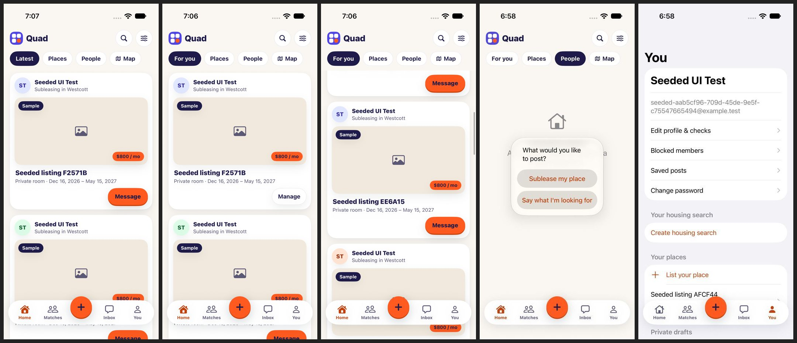
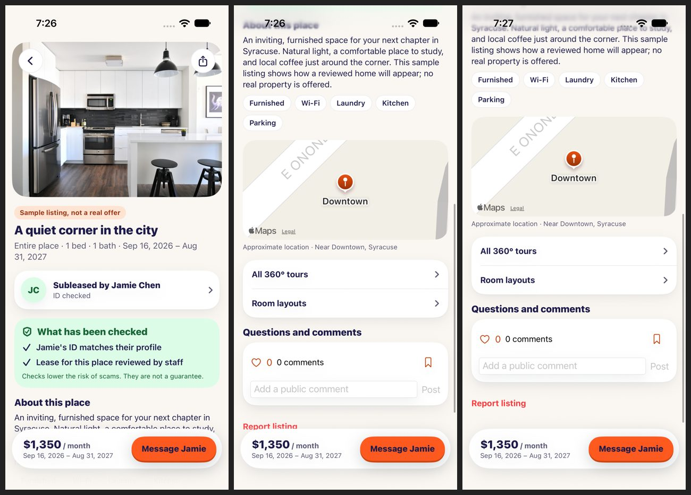

# Quad: the iPhone app's redesign

The iPhone app is being redrawn and renamed from CuseSublets to **Quad**. This page records the look, what has been rebuilt so far, and what is still in the old style. The repository, bundle identifier and server keep the CuseSublets name.

## Status

| Part | State |
| --- | --- |
| Colours, buttons, cards, chips, avatars, logo | Built (`QuadTheme.swift`) |
| App name on the home screen, app icon | Built ("Quad", three squares and an orange circle on indigo) |
| Floating tab bar with a raised Post button | Built (`QuadTabBar.swift`) |
| Home feed | Built (`BrowseView.swift`, `QuadFeed.swift`) |
| A sublease's page | Built (`ListingView` in `BrowseView.swift`) |
| Matches, profiles, Inbox and chat, You | Old style, under the new tab bar |
| Listing in steps with a scan step, sign-up questions | Not built |
| Scan and tour screens in the new colours | Not built |
| Building pages, building managers, staff tools in the app | Not built; these need new server features first |

Only light appearance is drawn. The app is locked to light until a dark palette exists.

The name has not had a trademark or App Store check. Other student apps already use "Quad", so the App Store listing will need a longer form such as "Quad: Student Sublets".

## The look

Each colour has one job.

| Colour | Value | Used for |
| --- | --- | --- |
| Orange | `#FF5A1F` | The main button on a screen, the Post button, prices |
| Deep orange | `#C2410C` | Orange that must be readable as text on white: the active tab, links in old screens |
| Green | `#15803D`, tint `#DCFCE7`, text `#166534` | Yes and done: check badges, "fits", selected answers, progress |
| Indigo | `#4F46E5`, text `#1E1B4B` | Kept small: the logo tile, body text, dark chips |
| Warm white | `#FAF7F2`, wells `#F4F0E8` | Backgrounds |

Main buttons carry dark text. White on this orange measures about 3:1, below what small text needs.

Cards are flat white with one soft shadow. Only main buttons look pressable, with a darker lower edge. Buttons shrink a little when pressed and spring back; this is skipped when Reduce Motion is on.

## How the pieces fit

- `QuadTheme.swift`: colours, `ButtonStyle`s (`.quadPrimary`, `.quadPrimaryWide`, `.quadSecondary`, `.quadIcon`), `quadCard()`, `QuadChip`, `QuadAvatar`, `QuadLogo`.
- `QuadFormat.swift`: text rules with no interface in them: date ranges ("Jan 5 – May 15"), initials, which avatar tint a person gets, and the four tabs.
- `QuadTabBar.swift`: the tab bar, the Post intent, and `QuadFlow`, a wrapping layout for chips.
- `QuadFeed.swift`: the two feed cards and the filter chips.

The system tab bar is hidden and `QuadTabBar` is drawn over the bottom of the tab view. Two details matter when adding screens:

- Every scrolling screen inside a tab gets a bottom margin (`QuadTabBar.reservedHeight`) so its last line clears the bar. A safe-area inset on the tab view or the navigation stack did not reach the screens inside, so this is a scroll-content margin set on each tab's stack.
- That margin also reaches strips that scroll sideways and adds a blank band under them. Put `.quadSidewaysScroll()` on any horizontal `ScrollView` inside a tab.

A screen with its own bar at the bottom, such as a sublease's page with its price bar, calls `.hidesQuadTabBar()` and drops the tab's bottom margin. Both floating bars use `quadBarFade()` so that content scrolling under them does not show through below.

A sublease's page shows the photos first, with a "Look around in 360°" button when the place has a published tour that is ready. It lists what staff have checked and, as plainly, what they have not: the person's ID and the lease. Sublet permission is no longer shown as a check.

The Post button asks a guest to log in. For a member it offers "Sublease my place" or "Say what I'm looking for", switches to the You tab and opens the matching editor there, because the You tab already owns both editors.

Interface tests find the tabs by identifier: `tab-home`, `tab-matches`, `tab-post`, `tab-inbox`, `tab-you`.

## Checking it

```sh
xcodebuild -project ios/CuseSublets.xcodeproj -scheme CuseSublets \
  -destination 'platform=iOS Simulator,name=YOUR_INSTALLED_IPHONE' \
  -derivedDataPath work/ios-build -only-testing:CuseSubletsTests \
  CODE_SIGN_IDENTITY=- CODE_SIGNING_ALLOWED=YES test
```

The interface tests need the isolated local API described in `ios/README.md`.

Last run on the Mac mini, 16 November 2026, iPhone 17 simulator: 163 unit tests, 9 marketplace interface tests and the capture app's interface test passed. The long journey test was skipped, as it is in CI. Nothing here has been run on a physical iPhone, and the 360° button on a sublease's page has not been seen with a real tour, because the local test data has none.





The screenshots use test accounts and sample listings only.

## Design source

The screens were agreed as mockups before building: home feed, matches, a sublease, a building's page, a profile, a conversation, listing a place (building, scan, upload, tour preview), sign-up questions, what you're looking for, building manager and staff. Decisions that shape later work:

- Tenants do not ask a building manager for permission inside the app. Managers see subleases in their building but do not approve them.
- Checks shown on a sublease are the person's ID and the lease, each reviewed by staff. Automatic checks may sort the staff queue; a person makes every approval.
- Managers can answer a review but not remove it.
