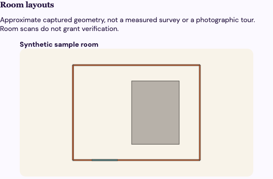

# iPhone validation — October 16, 2026

This is an initial implementation under validation. A simulator build does not establish device capture quality or App Store readiness.

Current executable change under test: reveal lower input fields after dismissing the preceding field’s keyboard, in addition to explicit keyboard dismissal and a Debug-only manual-password mode for controlled UI test input. The prior failures and their evidence are retained below; see the PR's latest iPhone check for the new execution result.

## Verified

- Web/Worker typecheck, all 45 unit tests and production web build passed locally. The existing large JavaScript bundle warning remains.
- An unsigned iPhone simulator build passed using Xcode 27.1. No signing or global developer-tool configuration was changed.
- Logs recovered from superseded GitHub runs confirm all four native model tests passed. Their UI test reached Browse, Matches, Inbox and login, then failed to find the name field after tapping the signup toggle. The captured accessibility tree showed the outer toggle row and inner switch separately, with the switch still off. The form now uses an explicit signup/login button; the test waits for the new field, scrolls controls into view, identifies multiline input explicitly and closes the editor through navigation. The initial UI failure is not treated as a pass.
- The run at `78f32b4` passed those four model tests and progressed through signup submission. Its API log shows successful account creation; the UI hierarchy shows Keychain storage failed in the unsigned simulator build. CI now uses local ad-hoc simulator signing and includes a Keychain save/read/delete test. Session storage has not been weakened or replaced with an insecure fallback. The revised native suite still requires a passing result.
- The signed run at `2b54502` passed all five native unit tests, including Keychain save/read/delete. Its recording showed the system “Use Strong Password?” sheet covering the signup form; generic app swipes could not dismiss it. The UI test now selects manual password entry through a Debug-only environment switch; normal signup retains new-password AutoFill, and Release ignores that switch. Password-manager interaction remains a separate device check. Login and listing forms also provide a keyboard Done control, and UI interactions dismiss the keyboard explicitly and scroll along the form margin to avoid embedded-map gestures. Full UI-flow success remains unverified until the next run.
- The run at `d1abb60` again passed all five native unit tests. Its screenshot and accessibility hierarchy show the password field underneath the email keyboard accessory; typing failed because the email field retained focus. The test now dismisses that keyboard before tapping the lower password field, and does the same for the listing address. This is an input-targeting correction, not a passing UI result.
- Two runtime tests passed against a fresh, isolated local database with migrations and synthetic seed data. They cover room-scan ownership, private upload, explicit publication/hiding, revocation when a listing is paused, unchanged verification fields, malformed input and retry behavior; and mobile-auth verifier binding, one-use codes and logout.
- GitHub [Checks at 1c37d81](https://github.com/ichen27/cusesublets/actions/runs/38959265778) passed. The [PR iPhone workflow](https://github.com/ichen27/cusesublets/actions/runs/38959265752) also passed its build/setup/API-runtime steps; its native test result was pending when this record was first written. Earlier duplicate and superseded native runs were cancelled.
- A browser check against the isolated API confirmed a published synthetic layout renders on the public listing with zero console warnings/errors. The checked-in [screenshot](screenshots/web-room-layout.png) and [sample geometry](fixtures/sample-room.json) are reusable evidence; they are not a real scan or a native-app screenshot.
- Standards and spec review findings were corrected; see [review](review.md).

## Unverified and release blockers

- The local simulator test run was interrupted after the mini's internal disk filled during simulator startup. No local native unit/UI test pass is claimed. The app and test targets compiled; a black simulator screenshot is not UI evidence.
- Real LiDAR capture, saved-capture recovery on a physical phone, interruptions/backgrounding, accessibility and room geometry accuracy need device testing.
- Hosted Google/Access authentication, mobile-code expiry and suspended-account native flows are not covered by the two runtime tests.
- Signing team, provisioning, bundle ownership and TestFlight distribution are not configured. No physical iPhone was available for this run.
- Full marketplace parity and photographic/Gaussian reconstruction remain open in the [implementation plan](iphone-plan.md).

## Operational state

Migration 0012 was applied only to isolated test data. No operational database was migrated or seeded. The hosted preview watches its checkout: it briefly picked up development assets before this was discovered. The canonical checkout was restored to stable main (`2e6d7b4`), rebuilt, and the public site was verified serving its stable bundle (`index-B-K9E7JA.js`). Feature work continues in a separate Git worktree. See the [deployment runbook](../deployment.md).

CI retains its result bundle and isolated API log as the `iphone-validation` artifact. Those contain synthetic test data only. The [Browse screenshot](screenshots/iphone-browse.png) was recovered from the run at `1c37d81`; its browsing screen is unchanged by the later signup fix. It demonstrates actual simulator rendering, not a completed interaction test. No signed distribution package is available. GitHub reports no protection on `main`; this draft is unmerged and does not claim enforced branch checks.

## Sample artifact

`fixtures/sample-room.json` contains four walls, a door and one simplified furniture box in metres. To reproduce the screenshot, use an isolated development datastore, authenticate as the synthetic listing's owner, add a UUID `id` to the fixture body, POST it to `/api/listings/{id}/scans`, explicitly publish that scan, then open `/#listing/{id}` anonymously. Do not send this fixture to operational data. The editable viewer is `src/RoomScans.tsx`.
